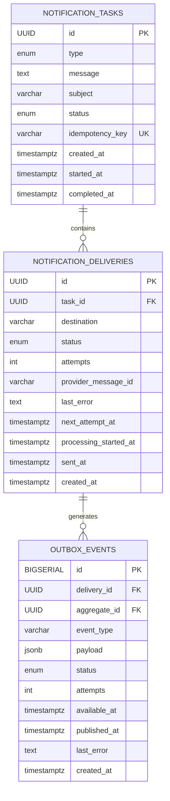

# Notification Service

A complete reference implementation for an asynchronous notification system.

## Architecture

```mermaid
flowchart LR
    C[Client]
    API[FastAPI API]
    DB[(PostgreSQL)]
    O[(Transactional Outbox)]
    D[Celery Beat / Outbox Dispatcher]
    R[(Redis Broker)]
    W1[Worker 1]
    W2[Worker 2]
    WN[Worker N]
    P[ThirdParty Provider]

    C -->|POST /api/v1/tasks/sms| API
    API -->|one transaction| DB
    DB --- O
    O --> D
    D --> R
    R --> W1
    R --> W2
    R --> WN
    W1 --> DB
    W2 --> DB
    WN --> DB
    W1 --> P
    W2 --> P
    WN --> P
    C -->|GET /api/v1/tasks/{id}| API
    API --> DB
```

### Why the outbox exists

Without an outbox there is a failure window:

1. API commits the task in PostgreSQL.
2. API crashes before publishing to Redis.
3. The task is stored forever but never processed.

The API therefore writes `notification_tasks`, `notification_deliveries`, and the corresponding outbox rows in the same PostgreSQL transaction. A dispatcher publishes the outbox rows later. Publishing is intentionally **at-least-once**, so a duplicate queue message is safe because the worker atomically claims each delivery and skips already-sent deliveries.

## Data model



## API

### Create SMS task

`POST /api/v1/tasks/sms`

Optional header:

`Idempotency-Key: <unique-client-key>`

Request:

```json
{
  "message": "Your verification code is 123456",
  "phone_numbers": ["+972501111111", "+972502222222"]
}
```

Response: `202 Accepted`

```json
{
  "task_id": "8d64e6ce-9cc4-4f1f-b2cf-78c16f4a9d9f",
  "status": "PENDING"
}
```

### Read result

`GET /api/v1/tasks/{task_id}`

Example:

```json
{
  "task_id": "8d64e6ce-9cc4-4f1f-b2cf-78c16f4a9d9f",
  "type": "SMS",
  "status": "PARTIAL",
  "deliveries": [
    {
      "destination": "+972501111111",
      "status": "SENT",
      "attempts": 1,
      "provider_message_id": "provider-1001"
    },
    {
      "destination": "+972502222222",
      "status": "FAILED",
      "attempts": 3,
      "last_error": "provider timeout"
    }
  ]
}
```

## Status semantics

- `PENDING`: accepted but no delivery has started.
- `PROCESSING`: at least one delivery is being processed and the task is not finished.
- `COMPLETED`: every delivery is `SENT`.
- `PARTIAL`: at least one delivery is `SENT` and at least one failed permanently.
- `FAILED`: every delivery failed permanently.

Delivery statuses:

`PENDING -> PROCESSING -> SENT`

or

`PENDING -> PROCESSING -> PENDING` (retry)

or

`PENDING -> PROCESSING -> FAILED` (no more retries)

## Retry and reliability

The worker retries transient provider failures with exponential backoff. The retry itself is represented as a new outbox event, so the DB and the schedule remain durable.

The implementation deliberately does **not** promise exactly-once external delivery. A provider call can succeed while the network response is lost, so the worker may retry. Exactly-once is only possible where the provider offers an idempotency key or equivalent guarantee.

A periodic reaper moves stale `PROCESSING` deliveries back to `PENDING` if a worker crashed after claiming them.

## Run locally

```bash
docker compose up --build
```

API: `http://localhost:8000`

Swagger: `http://localhost:8000/docs`

By default the project uses the bundled fake provider so it can run without vendor credentials. To use the real package, set `USE_FAKE_PROVIDER=false` and install the real `ThirdParty` package in the image/venv.

## Manual test

```bash
curl -X POST http://localhost:8000/api/v1/tasks/sms \
  -H 'Content-Type: application/json' \
  -H 'Idempotency-Key: demo-123' \
  -d '{
    "message": "Hello from the notification service",
    "phone_numbers": ["+972501111111", "+972502222222"]
  }'
```

Then:

```bash
curl http://localhost:8000/api/v1/tasks/<TASK_ID>
```

## Tests

```bash
pip install -r requirements.txt -r requirements-dev.txt
pytest -q
```

## Production hardening

For a production deployment I would add:

- Alembic migrations instead of `create_all`.
- Secret manager for provider credentials and DB passwords.
- TLS/authentication/rate limits on the API.
- Prometheus metrics and OpenTelemetry traces.
- Provider-specific error classification and provider idempotency keys.
- Redis HA or a managed queue service.
- PostgreSQL HA/read replica/backup policy.
- Per-tenant quotas and provider rate limiting.
- Dead-letter handling for poison messages.
- Data retention/PII minimization for phone numbers and message bodies.
